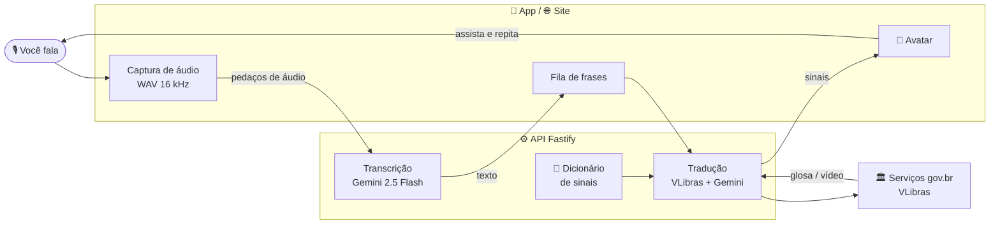

<div align="center">

# Libras IA

### Fale em português. Veja a frase sendo sinalizada em Libras por um avatar 3D.

[](https://www.typescriptlang.org/)
[](https://fastify.dev/)
[](https://reactnative.dev/)
[](https://expo.dev/)
[](https://react.dev/)
[](https://vite.dev/)
[](https://tailwindcss.com/)
[](https://unity.com/)
[](https://ai.google.dev/)
[](https://vlibras.gov.br/)
[](https://vitest.dev/)
[](https://vercel.com/)

**🎙️ fala → 📝 texto → 🔤 glosa → 🧍 sinais**

🌐 **Site:** [libras-ai-react.vercel.app](https://libras-ai-react.vercel.app)

</div>

---

## 📑 Índice

| | |
|---|---|
| [🎯 O que é](#user-content-o-que-e) | [🧍 Avatar e IA](#user-content-avatar-e-ia) |
| [✨ Funcionalidades](#user-content-funcionalidades) | [🔒 Privacidade](#user-content-privacidade) |
| [🧩 Como funciona](#user-content-como-funciona) | [🚀 Como rodar](#user-content-como-rodar) |
| [📱 Partes do projeto](#user-content-partes-do-projeto) | [☁️ Deploy e testes](#user-content-deploy-e-testes) |
| [🛠️ Tecnologias](#user-content-tecnologias) | [📝 Notas](#user-content-notas) |

---

<a id="o-que-e"></a>

## 🎯 O que é

O Libras IA é um **tradutor de português para Libras**. Você fala (ou digita) uma frase em português e o aplicativo mostra um **avatar 3D fazendo os sinais** correspondentes, com legendas e controle de velocidade.

A ideia é simples: **quebrar a barreira de comunicação** entre quem fala português e quem se comunica em Libras. Em vez de depender de um intérprete humano o tempo todo, a pessoa pode apontar o celular e ser entendida.

> 💡 **Em uma frase:** um aplicativo que ouve o que você diz, transforma em texto, traduz para a "forma escrita dos sinais" (glosa) e manda um avatar sinalizar.

### O que ele NÃO é

Para não gerar confusão, vale deixar claro:

| ❌ Não faz | ✅ Faz |
|---|---|
| Não lê sinais da câmera | Fala/texto → Libras |
| Não reconhece mãos com IA própria | Usa o serviço oficial **VLibras** do governo |
| Não traduz Libras → português | Português → Libras |
| Não é um curso de Libras | É um tradutor em tempo real |

---

<a id="funcionalidades"></a>

## ✨ Funcionalidades

| Recurso | O que faz, em palavras simples |
|---|---|
| 🎙️ **Captura de voz** | Ouve a fala em pedaços curtos e detecta quando você fez uma pausa |
| 📝 **Transcrição** | Transforma áudio em texto (com Gemini ou modo de demonstração) |
| 🔤 **Glosa** | Converte o texto para a forma escrita dos sinais, ex.: `OLÁ TUDO BEM [INTERROGAÇÃO]` |
| 🧍 **Avatar 3D** | Reproduz os sinais com o player oficial do VLibras |
| 🩹 **Avatar simulado** | Se o vídeo oficial não estiver disponível, mostra um boneco SVG e **avisar que é simulação** |
| 🕒 **Fila de sinais** | Organiza as frases para sinalizar uma por vez, sem embaralhar |
| ⏱️ **Métricas** | Mede o tempo entre falar e ver o sinal (mediana e p95) |
| 📱 **Três telas** | Traduzir, Histórico (visível na sessão) e Configurações |
| 🌐 **Versão web** | Mesma ideia no navegador, com player Unity embutido |

---

<a id="como-funciona"></a>

## 🧩 Como funciona



**Passo a passo em linguagem simples:**

1. **Ouvimos:** o microfone capta o som e o app divide a fala em pedaços naturais (ele percebe silêncio e pontuação).
2. **Escrevemos:** cada pedaço vira texto. No app mobile isso acontece em pedaços (`/api/transcriptions/chunks`); no site, por gravação curta (`/api/transcribe`).
3. **Traduzimos:** o texto vai para o VLibras oficial. Se alguma palavra não tiver sinal conhecido, o Gemini tenta ajudar — e a palavra é marcada como "sem sinal".
4. **Sinalizamos:** o player 3D recebe a glosa e anima o avatar. Se não houver token do serviço de vídeo, um avatar simples é usado e a interface avisa.
5. **Medimos:** o app registra quanto tempo levou da fala até o sinal.

> ⚠️ **Sem chave do Gemini**, a versão web não consegue transcrever áudio — mas você ainda pode digitar uma frase e ver o avatar sinalizar.

---

<a id="partes-do-projeto"></a>

## 📱 Partes do projeto

São **dois repositórios que trabalham juntos**:

| Repositório | O que contém | Como rodar |
|---|---|---|
| [`libras-ai`](https://github.com/Tyago-santos/libras-ai) (**principal**) | API Fastify + app mobile Expo + contratos + documentação + testes | `npm run dev:api` e `npm run dev:mobile` |
| [`libras-ai-react`](https://github.com/Tyago-santos/libras-ai-react) (web) | Site React/Vite + player Unity do VLibras | `npm run dev` ( porta `5174`) |

O site usa a API do repositório principal para transcrever áudio e como reserva na tradução. Ele também conversa direto com os serviços do VLibras — por isso consegue funcionar parcialmente mesmo com a API desligada.

### Estrutura do repo principal

```text
libras-ai/
├── apps/api/          API Fastify (porta 3000)
│   ├── src/features/transcriptions/   pedaços de fala, transcrição, Gemini
│   ├── src/features/translations/     fila, tradução e fallback
│   ├── src/features/avatar/           proxy do vídeo do avatar
│   ├── src/shared/providers/vlibras/  tradução, dicionário e vídeo
│   └── tests/                         33 testes
├── apps/mobile/       App Expo (Android/iOS)
│   ├── src/features/speech/           microfone, VAD e WAV
│   ├── src/screens/                   Traduzir, Histórico, Configurações
│   └── src/components/                AvatarViewport, AvatarSimulation, player de vídeo
├── packages/contracts/ schemas Zod compartilhados entre API e app
└── docs/              arquitetura e integração com VLibras
```

---

<a id="avatar-e-ia"></a>

## 🧍 Avatar e IA

| Peça | O que é | De onde vem |
|---|---|---|
| 🧠 **Gemini 2.5 Flash** | Transforma áudio em texto e ajuda a converter frases em glosa | Google (chamada REST direta, sem SDK) |
| 🏛️ **VLibras** | Tradução oficial português → glosa e dicionário de sinais | gov.br |
| 📖 **Dicionário** | Árvore de busca com os sinais da versão `2018.3.1` (~3,6 MB) | Carregada na memória ao iniciar |
| 🧍 **Player Unity WebGL** | Avatar 3D que executa os sinais no navegador | Arquivos locais em `public/vlibras-unity/` (~20 MB) |
| 🎬 **Vídeo MP4** | Animação oficial, quando há token da API Conecta | Serviço do governo |
| 🩹 **Avatar simulado** | Boneco SVG com poses calculadas por palavra | Criado no próprio app |

**Não há modelos de IA baixados** (`.tflite`, `.onnx`) — a inteligência vem de serviços externos. O único arquivo grande é o player Unity, que é um renderizador 3D, não um modelo treinado.

---

<a id="privacidade"></a>

## 🔒 Privacidade

- 🎙️ O app pede permissão de **microfone** (`RECORD_AUDIO` no Android, aviso no iOS). **Não usa câmera.**
- ⏳ Sessões expiram depois de **1 hora**.
- 🙈 Os logs escondem tokens e o áudio em base64.
- 🗑️ O histórico da versão web **não é salvo** — a própria tela avisa.

---

<a id="como-rodar"></a>

## 🚀 Como rodar

### Requisitos

| Requisito | Recomendado | Por quê |
|---|---|---|
| Node.js | **20.12+** | O backend usa `process.loadEnvFile` |
| npm | versão atual | Monorepo com workspaces |
| Expo Go | opcional | Para testar no celular |
| Chaves (opcionais) | Gemini e/ou token Conecta | Habilitam transcrição real e vídeo oficial |

> 📌 Os dois repositórios estão na branch **`master`** (não `main`) e hoje são **privados** — você precisa de acesso à conta para clonar.

### 1. API

```bash
git clone https://github.com/Tyago-santos/libras-ai.git
cd libras-ai
cp .env.example apps/api/.env
npm install
npm run dev:api
```

A API sobe em **http://localhost:3000**. Teste com:

```bash
curl http://localhost:3000/api/health
```

### 2. App mobile (Expo)

```bash
npm run dev:mobile
```

Use o QR Code no **Expo Go**. Para testar no celular físico, aponte para o IP da sua máquina:

```bash
EXPO_PUBLIC_API_URL=http://SEU_IP:3000 npm run dev:mobile
```

> 💡 No emulador Android, o endereço `http://10.0.2.2:3000` já aponta para o seu computador.

### 3. Site web

```bash
git clone https://github.com/Tyago-santos/libras-ai-react.git
cd libras-ai-react
npm install
npm run dev
```

O site abre em **http://127.0.0.1:5174**. Para usar a API local:

```bash
VITE_API_URL=http://localhost:3000 npm run dev
```

### Variáveis de ambiente (principais)

| Variável | Para que serve | Padrão |
|---|---|---|
| `PORT` / `HOST` | Onde a API escuta | `3000` / `0.0.0.0` |
| `PUBLIC_BASE_URL` | Monta o link do vídeo do avatar | `http://localhost:3000` |
| `VLIBRAS_TRANSLATE_URL` | Tradução oficial | endpoint gov.br |
| `VLIBRAS_DICTIONARY_URL` | Dicionário de sinais | versão `2018.3.1` |
| `VLIBRAS_API_TOKEN` | Token Conecta para vídeo oficial | vazio → simulação |
| `SPEECH_PROVIDER` | `mock` ou `gemini` | `mock` |
| `GEMINI_API_KEY` | Chave do Gemini | vazia |
| `GEMINI_MODEL` | Modelo usado | `gemini-2.5-flash` |
| `GEMINI_API_KEY_FALLBACKS` | Chaves extras se limite atingido | ausente do `.env.example` |
| `QUEUE_CONCURRENCY` | Quantas traduções ao mesmo tempo | `4` |
| `EXPO_PUBLIC_API_URL` (app) | Endereço da API no celular | `http://10.0.2.2:3000` |
| `VITE_API_URL` (site) | Endereço da API no navegador | `http://localhost:3000` |

### Outros comandos

```bash
npm test          # 33 testes (API + contratos)
npm run typecheck # checagem de tipos
npm run build     # compila os contratos; API roda com tsx e app com Expo
```

---

<a id="deploy-e-testes"></a>

## ☁️ Deploy e testes

| Parte | Situação |
|---|---|
| 🌐 Site | Publicado na **Vercel** (`vercel.json` com rewrite para SPA) |
| ⚙️ API | Deployada em Node, mas **sem configuração de deploy versionada** no repo |
| 🧪 Testes | **33 casos** com Vitest: provedores VLibras (11), fila (7), gerenciador de frases (12), contratos (3) |
| 🧪 Site web | Sem testes e sem README próprio |

---

<a id="tecnologias"></a>

## 🛠️ Tecnologias

| Camada | Stack |
|---|---|
| ⚙️ API | Node.js ≥20 · Fastify 5 · TypeScript · Zod · tsx · Vitest |
| 📱 Mobile | Expo 58 · React Native 0.88 · React 19 · expo-audio · expo-video · zustand · styled-components |
| 🌐 Web | React 19 · Vite 6 · Tailwind 3 · React Router 7 · Unity WebGL |
| 🤖 IA | Gemini 2.5 Flash (REST) · VLibras (gov.br) · dicionário 2018.3.1 |
| ☁️ Infra | npm workspaces · Vercel |

---

<a id="notas"></a>

## 📝 Notas

- 📌 O branch é **`master`**, e os repositórios estão **privados** — o link do perfil só abre para quem tiver acesso.
- 📌 Sem `VLIBRAS_API_TOKEN`, o avatar oficial não gera vídeo: o app mostra uma simulação e avisa. O proxy `/api/animations/:id` parece incompleto no código atual.
- 📌 O selo "Libras Oficial" aparece sobre uma **imagem estática** na tela inicial; o avatar real só atua nas telas de sinalização.
- 📌 As opções de acessibilidade e velocidade em Configurações são **visuais** (mudam classes/DOM), sem efeito real no motor de voz.
- 📌 Para transcrever pelo app mobile, não basta a chave do Gemini: é preciso `SPEECH_PROVIDER=gemini`.
- 📌 Os scripts `.py` do repo web são utilitários de desenvolvimento com caminhos absolutos da máquina original.

---

<div align="center">

Feito com 💙 por **Tiago Santos** — acessibilidade de verdade, um sinal de cada vez.

[](https://github.com/Tyago-santos)
[](https://www.linkedin.com/in/tiago-santos-b10165376/)

</div>
